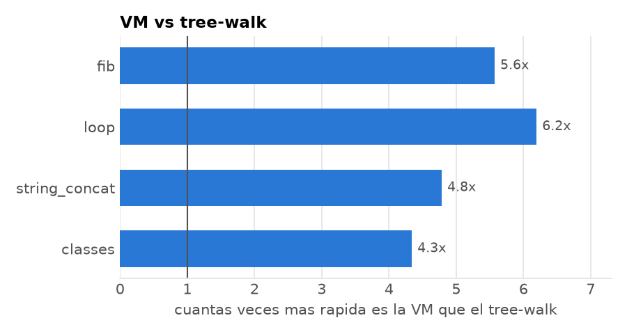
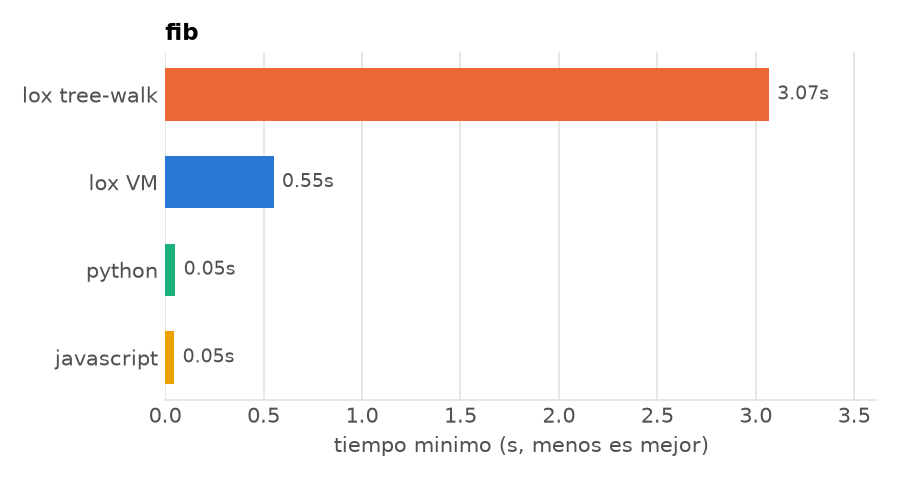
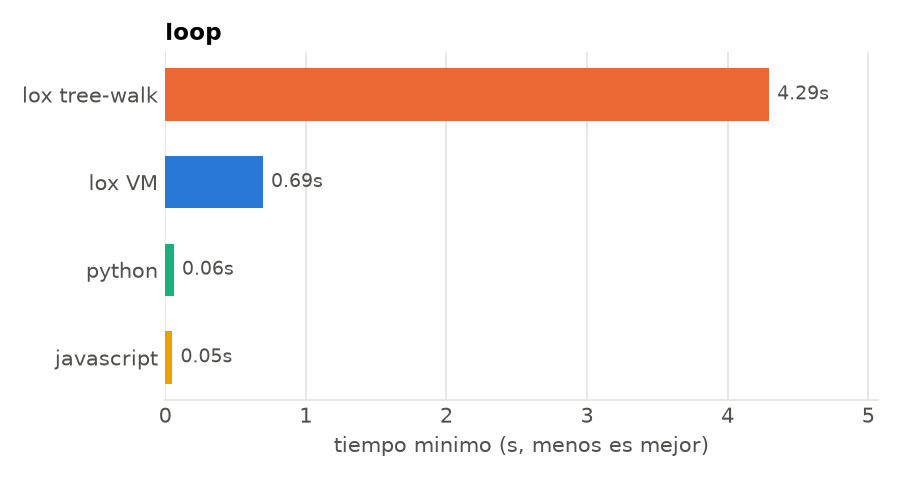
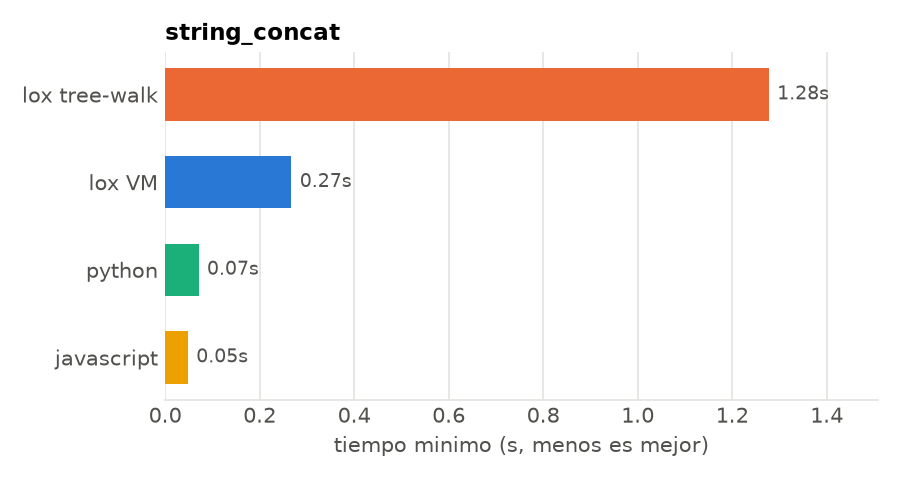
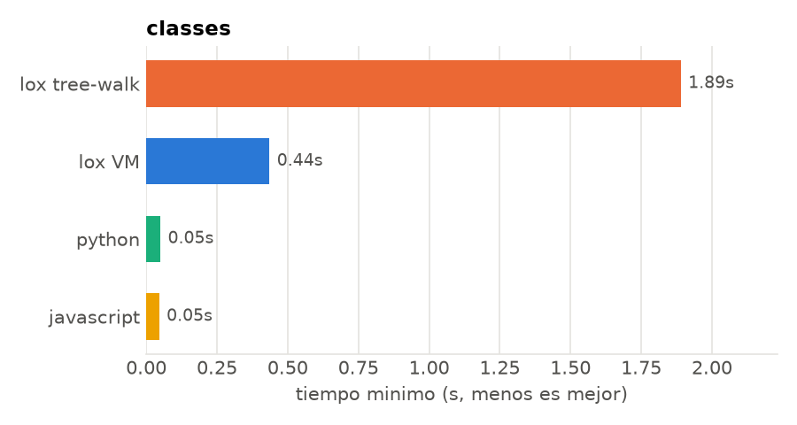

# Reporte de benchmarks

Tiempo de proceso completo (incluye el arranque del runtime) en segundos: minimo, promedio y maximo de 5 corridas por combinacion.

## VM vs tree-walk

| Benchmark | Tree-walk (s) | VM (s) | VM mas rapida |
|---|---:|---:|---:|
| fib | 3.0663 | 0.5507 | 5.6x |
| loop | 4.2935 | 0.6934 | 6.2x |
| string_concat | 1.2774 | 0.2672 | 4.8x |
| classes | 1.8899 | 0.4358 | 4.3x |

## Fib

**Que se probo:** Recursion y llamadas a funcion: calcula `fib(24)` de forma recursiva (sin memoizacion), la misma logica en todos los lenguajes.

| Implementacion | Min (s) | AVG (s) | Max (s) |
|---|---:|---:|---:|
| lox tree-walk | 3.0663 | 3.0829 | 3.0936 |
| lox VM | 0.5507 | 0.5541 | 0.5607 |
| python | 0.0514 | 0.0532 | 0.0568 |
| javascript | 0.0462 | 0.0492 | 0.0523 |

## loop

**Que se probo:** Loop apretado: un `while` de 200.000 iteraciones que en cada vuelta evalua una condicion, hace una suma y un incremento sobre variables globales.

| Implementacion | Min (s) | AVG (s) | Max (s) |
|---|---:|---:|---:|
| lox tree-walk | 4.2935 | 4.3461 | 4.4698 |
| lox VM | 0.6934 | 0.7082 | 0.7205 |
| python | 0.0598 | 0.0633 | 0.0663 |
| javascript | 0.0495 | 0.0511 | 0.0526 |

## string_concat

**Que se probo:** Creacion/descarte de strings: 50.000 concatenaciones sucesivas que arman una cadena de largo creciente (con variables locales).

| Implementacion | Min (s) | AVG (s) | Max (s) |
|---|---:|---:|---:|
| lox tree-walk | 1.2774 | 1.2855 | 1.2999 |
| lox VM | 0.2672 | 0.2738 | 0.2786 |
| python | 0.0708 | 0.0758 | 0.0806 |
| javascript | 0.0481 | 0.0501 | 0.0525 |

## classes

**Que se probo:** Clases: 30.000 llamadas a un metodo que lee campos de dos instancias y crea una instancia nueva (pasa por `init`).

| Implementacion | Min (s) | AVG (s) | Max (s) |
|---|---:|---:|---:|
| lox tree-walk | 1.8899 | 1.9059 | 1.9312 |
| lox VM | 0.4358 | 0.4404 | 0.4460 |
| python | 0.0501 | 0.0534 | 0.0580 |
| javascript | 0.0457 | 0.0486 | 0.0538 |

